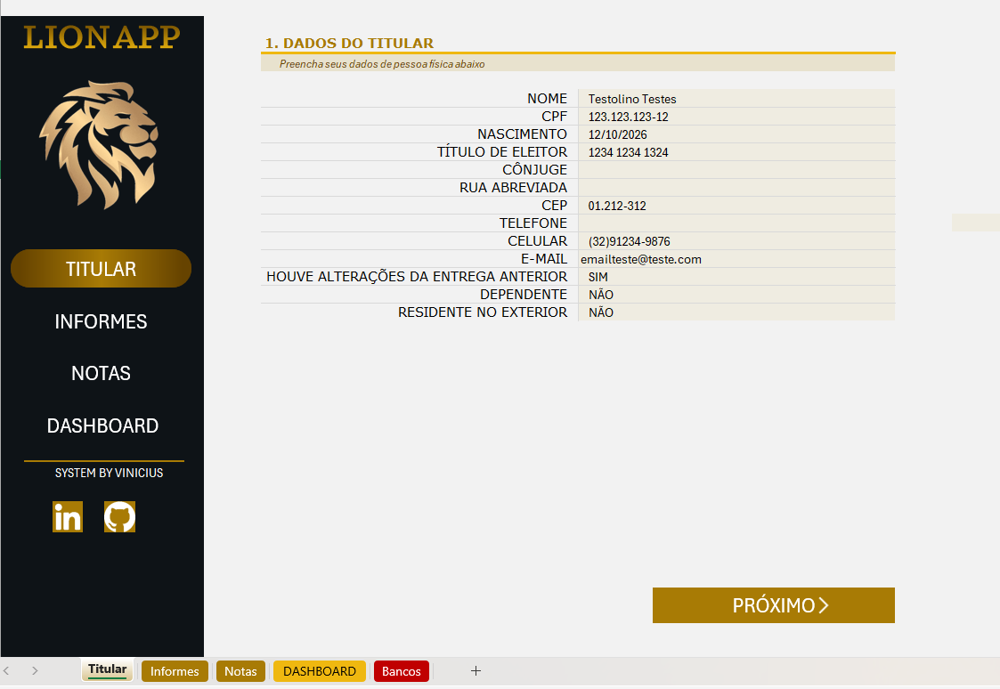
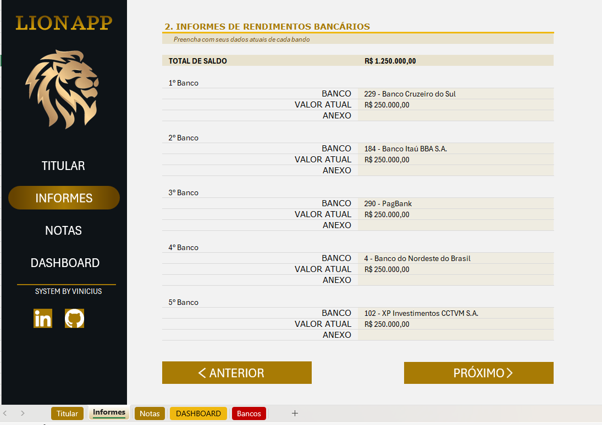
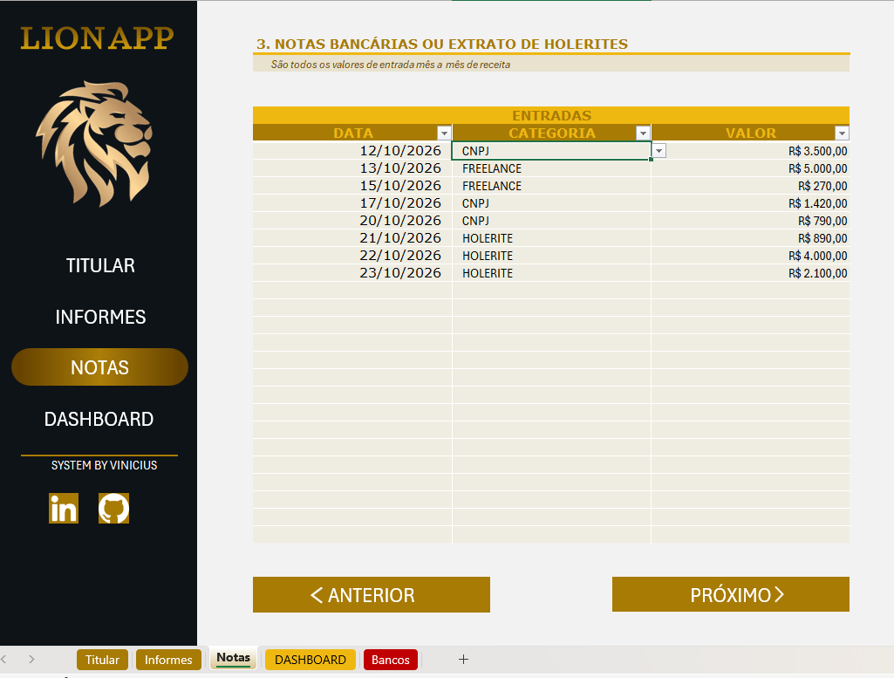
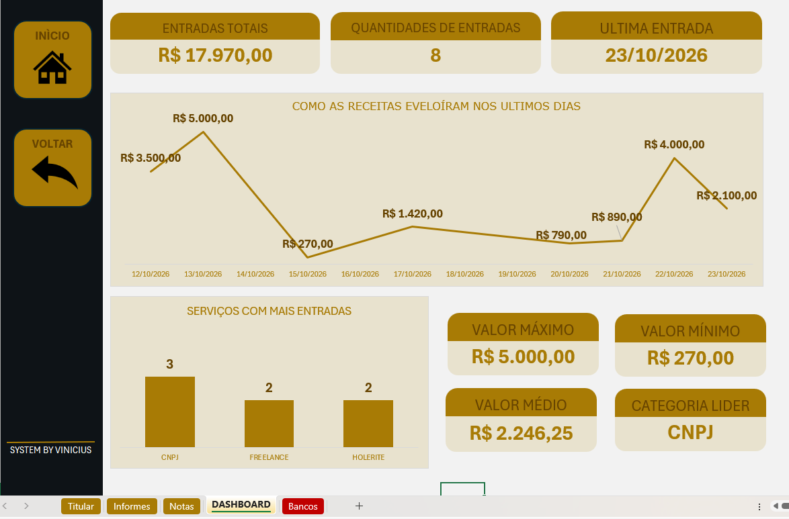

### Descrição do Desafio

Este projeto tem como objetivo criar uma ferramenta no Excel que ajude a organizar e reunir informações essenciais para a declaração de imposto de renda. A proposta era construir um agregador de dados no qual o usuário possa controlar suas entradas de maneira eficiente e validada, com menus de navegação, validações automáticas e funcionalidades extras, como links rápidos. A solução será completamente construída no Excel, com recursos que tornam a ferramenta robusta, mas com uma interface amigável e prática.

> **Observação:** os dados preenchidos na pasta de trabalho são fictícios e foram incluídos apenas para demonstração e testes.

Partindo do arquivo-base, fiz modificações tanto na estrutura quanto no visual.
Ferramenta utilizada: Excel

#### Estrutura das abas

##### Titular

Reúne dados pessoais e de contato, como nome, CPF, data de nascimento, título de eleitor, cônjuge, endereço, CEP, telefone, celular e e-mail. Também apresenta campos sobre alterações na declaração anterior, dependentes e residência no exterior.

##### Informes

Permite registrar informações de até cinco bancos, com o nome da instituição, o valor atual e um campo para anexo. A página também apresenta o total dos saldos informados.

##### Notas

Registra cada entrada com data, categoria e valor. A categoria é selecionada em uma lista suspensa com validação de dados e três opções: CNPJ, Freelancer e Holerite. Como os registros representam entradas por serviços, espera-se que os valores não sejam negativos; essa é uma orientação de preenchimento, não uma validação automática da planilha.

##### Dashboard

Reúne indicadores e gráficos para acompanhar os valores registrados, a evolução das entradas ao longo do tempo e a quantidade de entradas por categoria.

##### Bancos

Apresenta uma lista de instituições bancárias.

#### O que fiz no projeto:

Com base no projeto original, comecei a fazer algumas modificações no layout e no visual para praticar algumas técnicas.

- No visual, mudei as cores para preto e dourado, usando alguns tons de dourado e areia para combinar:
    - #664300
    - #A87B05 
    - #EFB810
    - #E8E2CE
    - #EFECE1
    - #F2F2F2

- No layout, criei uma planilha de dashboard, na qual:
    - Criei alguns gráficos que mostram as receitas ao longo dos dias:
        - Gráfico de linhas que mostra a relação entre os valores de entrada e as datas.
        - Gráfico de barras que mostra a contagem de entradas por categoria.

    - Criei cartões com alguns KPIs:
        - Entrada Total: soma dos valores de entrada.
        - Quantidade de entradas: contagem do número de entradas.
        - Última entrada: data da última entrada adicionada.
        - Valor máximo: maior valor adicionado.
        - Valor mínimo: menor valor adicionado.
        - Valor médio: média dos valores.
        - Categoria líder: nome da categoria com mais entradas.

    - Adicionei dois botões:
        - Botão Início, para voltar à primeira página, intitulada "Titular".
        - Botão Voltar, para retornar à página anterior.

- Adicionei outro botão ao menu lateral, que leva ao dashboard.
- Adicionei dois ícones:
    - LinkedIn: leva à minha página do LinkedIn.
    - GitHub: leva à minha página do GitHub.

- As páginas contêm botões "Anterior" e "Próximo", que permitem voltar à página anterior ou avançar para a próxima.
- Usei funções para buscar os valores conforme necessário.
    - No cartão "Categoria líder", usei duas funções:
        - MÁXIMO(): para encontrar a maior quantidade de entradas entre as categorias.
        - PROCX(): usada junto com a função MÁXIMO() para buscar o nome da categoria com o maior valor.

- Usei hiperlinks para conectar as planilhas.

- Todo o Dashboard é dinâmico: quando os valores da pasta de trabalho mudam, seus gráficos e indicadores são atualizados, principalmente quando há alterações nos lançamentos da aba "Notas".